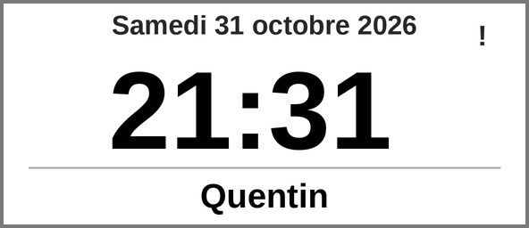
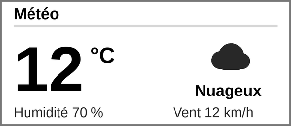
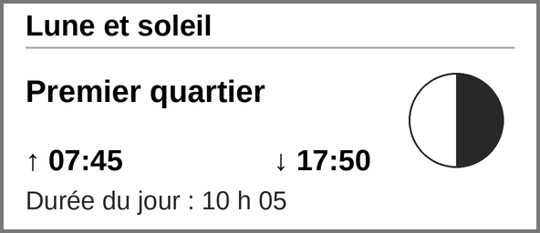

# Horloge e-Paper WeAct Studio 2.9" (ESP8266, WeMos D1 mini)

## Câblage

Brochage officiel, d'après l'exemple `EpaperModuleTest_Arduino_ESP8266` du dépôt WeActStudio.EpaperModule.

| Broche connecteur | Signal | Couleur | D1 mini | GPIO |
|---|---|---|---|---|
| 1 | BUSY | violet | D0 (violet) | GPIO16 |
| 2 | RES | orange | D1 (orange) | GPIO5 |
| 3 | D/C | blanc | D2 (blanc) | GPIO4 |
| 4 | CS | bleu | D8 (bleu) | GPIO15 |
| 5 | SCL (CLK) | vert | D5 (vert) | GPIO14 |
| 6 | SDA (DIN) | jaune | D7 (jaune) | GPIO13 |
| 7 | GND | noir | GND (noir) | - |
| 8 | VCC | rouge | 3V3 (rouge) | - |

Pilote : `GxEPD2_290_BS` (DEPG0290BS, SSD1680).

Le bouton de page est sur D6 (GPIO12), vers GND, actif à LOW : D6 est libre avec ce câblage.

Version ESP8266 (D1 mini) de l'horloge e-Paper WeAct Studio 2.9" (296 × 128). Voir la version ESP32 pour le reste du projet.

## Pages

Un appui sur le bouton D6 fait défiler les pages : horloge → météo → lune et soleil → horloge.

Rendus de référence (296 × 128, agrandis), générés pour la maquette :

### Horloge (page par défaut)

- Date centrée en haut (Roboto Bold 18).
- Heure en grand (Roboto Bold 64) ; le « ! » en haut à droite signale une heure non fiable (Wi-Fi ou NTP).
- Saint du jour centré en bas.

### Météo

- Source : Open-Meteo (sans clé), coordonnées de Saint-Martin-de-Crau.
- Affichée pendant 10 secondes, puis retour à l'horloge.

### Lune et soleil

- Lever et coucher du soleil calculés localement, phase de la lune en icône.
- Affichée jusqu'au prochain appui sur D6.

### Erreur

- Affichée au démarrage si le Wi-Fi ou la synchronisation NTP échoue.

## Logiciel

- Carte : « LOLIN(WEMOS) D1 mini » (paquet ESP8266, URL du gestionnaire : `http://arduino.esp8266.com/stable/package_esp8266com_index.json`).
- Partition : schéma avec OTA, par exemple « 4MB (FS:none, OTA ~1019KB) ».
- Vitesse SPI : 1 MHz dans `weact_esp8266.ino` (fonction `setupHSPI`).
- Le brochage de l'écran est défini dans `GxEPD2_display_selection_new_style.h`, branche ESP8266 (CS=15, DC=4, RST=5, BUSY=16).
- L'écran de démarrage vient de `epd_bitmap_296` (`bitmaps.h`), identique à la version ESP32.
